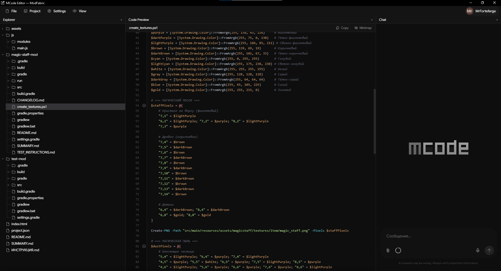

<div align="center">

# ⚡ MCode Editor

**A modern, lightweight desktop code editor built with C# (.NET 8) and WebView2.**

MCode Editor combines the performance of native Windows applications with the flexibility and modern UI capabilities of web technologies. It provides a sleek, dark-themed workspace with an integrated terminal, file explorer, and an extensible chat workspace.




</div>

## Features

*   **Modern UI/UX:** A meticulously crafted dark theme interface (`#0e0e0e`) with smooth pane animations, drag-and-drop layout management, and native-feeling custom UI elements.
*   **Code Preview & Editing:** Built-in syntax highlighting, line numbering, code folding, and a minimap for large files.
*   **Integrated Terminal:** Fully functional PowerShell terminal embedded directly into the workspace. Supports command history, custom prompts, and standard input/output streaming.
*   **File Explorer:** A robust tree-view explorer with support for creating, renaming, deleting, and moving files. Includes drag-and-drop support for external files.
*   **Extensible Workspace:** A modular tool system allowing users to open, close, and rearrange different panes (Explorer, Code Preview, Chat/Task Panel).
*   **Chat Workspace (Beta):** An integrated communication panel designed for workflow automation and external API integrations. *(Note: Default built-in models are temporarily disabled pending infrastructure updates. Custom endpoints can be configured in settings).*
*   **Browser Bridge (Optional):** A secure local proxy allowing the application to route specific API requests through an external browser, useful for bypassing strict network restrictions or utilizing VPNs.

## Tech Stack

*   **Backend:** C# / .NET 8 (WinForms)
*   **Frontend:** HTML5, CSS3, Vanilla JavaScript
*   **Web Engine:** Microsoft Edge WebView2 (Chromium)
*   **Architecture:** Hybrid IPC (Inter-Process Communication) via JSON WebMessages for seamless C# to JavaScript data transfer without heavy frameworks.

## Getting Started

### Prerequisites

*   **OS:** Windows 10 or Windows 11.
*   **Framework:** [.NET 8.0 SDK](https://dotnet.microsoft.com/download/dotnet/8.0).
*   **Runtime:** [WebView2 Runtime](https://developer.microsoft.com/en-us/microsoft-edge/webview2/) (Pre-installed on most modern Windows systems).

### Installation & Build

1. Clone the repository:
   ```bash
   git clone https://github.com/mythicgames-ru/MCode.git
   cd MCode
   ```

2. Build and run the application:
   ```bash
   dotnet run
   ```

## Architecture Overview

The application is split into two distinct layers:
1.  **The Core (C#):** Handles OS-level operations, file system management, process execution (PowerShell), and secure network requests.
2.  **The UI (Web):** Handles rendering, layout management, and user interactions. Served locally via embedded resources intercepted by WebView2.

Communication between the two layers is strictly typed and heavily optimized to prevent UI stuttering during heavy operations (like streaming text or reading large files).

## Configuration

You can access the settings menu via the top navigation bar. 
*   **Endpoints:** Configure custom API integrations (OpenAI-compatible, Anthropic) by providing your Base URL, API Key, and Model ID.
*   **Developer Settings:** Enable features like *Browser Bridge* or *Auto-approve Commands* (use with caution).

## Security & Safety

MCode Editor includes built-in safeguards when executing terminal commands:
*   Destructive commands (e.g., recursive force deletes, disk formatting, registry edits) are automatically blocked by the C# backend.
*   Commands executed via the workspace require user confirmation (unless auto-approve is explicitly enabled in settings).

## Contributing

Contributions are welcome! Whether it's fixing bugs, improving UI animations, or adding new workspace tools.

1. Fork the Project
2. Create your Feature Branch (`git checkout -b feature/AmazingFeature`)
3. Commit your Changes (`git commit -m 'Add some AmazingFeature'`)
4. Push to the Branch (`git push origin feature/AmazingFeature`)
5. Open a Pull Request

## License

Distributed under the MIT License. See `LICENSE` for more information.
